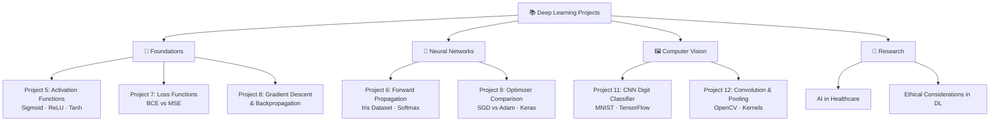

<p align="center">
  
</p>

<p align="center">
  
  
  
  
  
  
  
</p>

---

## 📋 Executive Summary

A comprehensive collection of **deep learning projects** covering foundational to advanced topics in neural network theory and practice. Each project is implemented as an independent Jupyter Notebook, progressing from activation function analysis and loss function comparisons to building **Convolutional Neural Networks (CNNs)** for image classification. The repository also includes research documents on **AI in Healthcare** and **Ethical Considerations in Deep Learning**.

This portfolio demonstrates hands-on expertise in forward propagation, backpropagation mechanics, optimizer benchmarking, convolution operations, and end-to-end CNN pipelines on real-world datasets.

---

## 📑 Table of Contents

- [Key Features & Capabilities](#-key-features--capabilities)
- [Project Catalog](#-project-catalog)
- [System Architecture](#-system-architecture)
- [Tech Stack Breakdown](#-tech-stack-breakdown)
- [Quickstart & Setup](#-quickstart--setup)
- [Project Directory Layout](#-project-directory-layout)
- [Author & Contributions](#-author--contributions)

---

## ✨ Key Features & Capabilities

- **Activation Function Analysis** — Implementation and visualization of Sigmoid, ReLU, and Tanh with comparative plots across input ranges
- **Neural Network Forward Propagation** — From-scratch forward pass using Iris dataset with ReLU hidden layers and Softmax output
- **Loss Function Comparison** — Binary Cross-Entropy vs MSE analysis with manual computation and interpretation
- **Gradient Descent & Backpropagation** — Step-by-step weight update visualization with convergence analysis using NumPy and Matplotlib
- **Optimizer Benchmarking** — SGD vs Adam optimizer comparison on a Keras neural network with accuracy and loss metrics
- **CNN for Digit Classification** — Handwritten digit recognition using TensorFlow/Keras CNN on MNIST with confusion matrix and classification report
- **Convolution & Pooling Operations** — Manual implementation of convolution kernels and max pooling on images using OpenCV
- **AI in Healthcare Research** — Presentation document exploring AI applications in medical diagnostics
- **Ethical Considerations in DL** — Research document on responsible AI, bias, and ethical frameworks

---

## 📖 Project Catalog

| Project | Notebook / Document | Topic | Key Libraries |
|---------|-------------------|-------|---------------|
| **Project 5** | `DL_Project_5_.ipynb` | Activation Functions (Sigmoid, ReLU, Tanh) | NumPy, Matplotlib |
| **Project 6** | `Project_6_.ipynb` | Neural Network Forward Propagation (Iris) | NumPy, Scikit-learn |
| **Project 7** | `PROJECT_7.ipynb` | Loss Functions — BCE vs MSE | NumPy |
| **Project 8** | `PROJECT_8.ipynb` | Gradient Descent & Backpropagation | NumPy, Matplotlib |
| **Project 9** | `Project_9.ipynb` | Optimizer Comparison — SGD vs Adam | TensorFlow, Keras, Scikit-learn |
| **Project 11** | `Project_11.ipynb` | CNN — Handwritten Digit Classification (MNIST) | TensorFlow, Matplotlib |
| **Project 12** | `Project_12.ipynb` | Understanding Convolution & Pooling | OpenCV, NumPy, Matplotlib |
| **Research** | `AI_in_Healthcare.pptx.pdf` | AI Applications in Healthcare | — |
| **Research** | `Project3_DL.docx` | Deep Learning Concepts | — |
| **Research** | `Project4_Ethical_Considerations_DL.docx` | Ethical Considerations in DL | — |

---

## 🏗️ System Architecture



---

## 🛠️ Tech Stack Breakdown

| Category | Technology | Purpose |
|----------|-----------|---------|
| **Language** | Python 3.8+ | Core programming language |
| **Deep Learning** | TensorFlow / Keras | CNN model building, training, and evaluation |
| **Scientific Computing** | NumPy | Array operations, manual neural net implementations |
| **Machine Learning** | Scikit-learn | Data loading (Iris), preprocessing, train/test split |
| **Computer Vision** | OpenCV | Image processing, convolution operations |
| **Visualization** | Matplotlib | Plotting activation functions, training curves, confusion matrices |
| **Notebooks** | Jupyter Notebook | Interactive development and documentation |
| **Platform** | Google Colab | Cloud-based GPU execution environment |

---

## 🚀 Quickstart & Setup

### Prerequisites

- Python 3.8 or higher
- Jupyter Notebook or Google Colab (recommended)

### Installation

```bash
# Clone the repository
git clone https://github.com/Chaturyathukivakam/Deep-Learning-Projects.git
cd Deep-Learning-Projects

# Create and activate virtual environment
python -m venv venv
source venv/bin/activate        # macOS / Linux
# venv\Scripts\activate          # Windows

# Install dependencies
pip install numpy matplotlib tensorflow scikit-learn opencv-python jupyter
```

### Run the Notebooks

```bash
# Launch Jupyter
jupyter notebook

# Or open any .ipynb file directly in Google Colab
```

> 💡 **Tip:** Projects 9 and 11 benefit from GPU acceleration. Use Google Colab with a GPU runtime for best performance.

---

## 📂 Project Directory Layout

```
Deep-Learning-Projects/
├── DL_Project_5_.ipynb                      # Activation Functions — Sigmoid, ReLU, Tanh
├── Project_6_.ipynb                         # Neural Network Forward Propagation (Iris)
├── PROJECT_7.ipynb                          # Loss Functions — BCE vs MSE
├── PROJECT_8.ipynb                          # Gradient Descent & Backpropagation
├── Project_9.ipynb                          # Optimizer Comparison — SGD vs Adam
├── Project_11.ipynb                         # CNN Digit Classification (MNIST)
├── Project_12.ipynb                         # Convolution & Pooling Operations
├── AI_in_Healthcare.pptx.pdf                # Research — AI in Healthcare
├── Project3_DL.docx                         # Research — Deep Learning Concepts
├── Project4_Ethical_Considerations_DL.docx   # Research — Ethical Considerations
└── README.md                                # Project documentation
```

---

## 👤 Author & Contributions

**Chaturya Thukivakam**

[](https://github.com/Chaturyathukivakam)

Contributions, issues, and feature requests are welcome! Feel free to open a pull request.

---

<p align="center">
  
</p>
